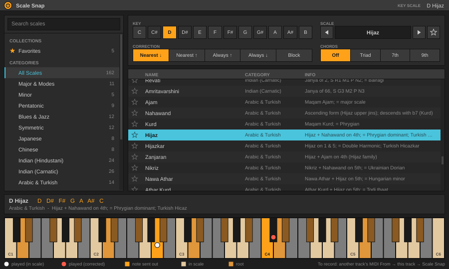

# Scale Snap for Max for Live

Two devices:

* **`Scale Snap.amxd`** (MIDI effect): keeps what you play in key. Details below.
* **`Scale Snap Detect.amxd`** (audio effect): listens to the audio of any track, finds its key and scale, and can
  hand the answer to Scale Snap (see *Scale Snap Detect* below).

`Scale Snap.amxd` keeps what you play in key. It sits in the MIDI-effect slot **in front of your
instrument on the same track** (no second track, no routing), with the same 162-scale library as the
VST3 plus key/scale **detection** from your playing or from a clip.

Target: **Ableton Live 11 Suite** (or Standard with Max for Live) with the Max 8 that ships inside Live.
It is plain Max 8: no `[v8]`, and the JavaScript is ES5 for the legacy `[js]` object.

> Status: everything that can be tested outside Live is tested (see *Tests*). The device has been built
> to the documented `.amxd` format but **has not been opened in Live yet**. The list of things to
> confirm on a real Live 11 is at the end of this file.

## Install

1. Get the files from the `ScaleSnap-M4L` artifact of the latest successful "Build" run (GitHub, Actions tab),
   or build them yourself (`python3 m4l/tools/build_amxd.py`, output in `m4l/dist/`):
   `Scale Snap.amxd` + `scalesnap.js` (MIDI effect) and `Scale Snap Detect.amxd` + `scalesnap_detect.js` +
   `ssd.spec.maxpat` (audio effect, see below).
2. Put both files **in the same folder**. A good place is your User Library:
   `Presets/MIDI Effects/Max MIDI Effect/` (in Live's browser: right-click *Max MIDI Effect* >
   *Show in Finder/Explorer*).
3. Drag **Scale Snap** onto a MIDI track, before the instrument.
4. **One-time, recommended: freeze it** so it no longer needs `scalesnap.js` next to it.
   Click the Edit button in the device's title bar, click the snowflake (*Freeze Device*) in the Max
   window, then *File > Save* (or *Save As* into your User Library). The frozen file is self-contained.
   Do not commit frozen devices.

The `.amxd` references `scalesnap.js` by name. Unfrozen, Max finds it next to the device. If the scale
menu stays empty, open the Max console (Edit button, *Window > Max Console*) and look for errors
mentioning `scalesnap.js`. If the script fails to load the device passes notes through unchanged
(it never goes silent): the realtime path does not depend on the script.

## Using it


*(the screenshot shows the VST3; the M4L device has the same controls in Live's own look)*

| Control | What it does |
|---|---|
| **Snap** (toggle) | On: notes are corrected. Off: notes pass through unchanged (notes already held are still released correctly). Automatable. |
| **Key** | Root note, C to B. Automatable. |
| **Category** | Filters the Scale menu: All Scales, Favorites, or one of the 17 categories. |
| **Scale menu**, **<** **>** | Pick a scale. The arrows step through the scales in the current Category (wrap around). The arrows are mappable to a controller or footswitch. |
| **Fav** | Adds or removes the current scale from your favorites. |
| **Correction** | Nearest (tie down), Nearest (tie up), Always up, Always down, **Block** (wrong notes make no sound). |
| keyboard | Shows the notes of the current scale over three octaves. |
| **Snap Clip** | Rewrites the selected MIDI clip to the current key/scale (see below). |
| **Detect** | See below. |

Non-note MIDI (CC, pitch bend, channel pressure, sustain, program change, system messages) passes through **byte
for byte**: it never enters the note path, so a 14-bit pitch bend keeps its fine resolution.
Polyphonic aftertouch follows the corrected note of the key that is held.

**No stuck notes.** The device remembers which note each key actually produced. Releasing a key always
releases that note, even if you changed key/scale in the meantime. Two keys that snap to the same note
share it (the note is released when the last of them is released). If the device is switched off while
keys are held, it releases what it is sounding.

### Recording and Snap Clip

Live records the **input** of a track (what you played, before MIDI effects). You hear the corrected
notes, but a clip you record from this track contains your original notes. Two ways to get corrected notes
into a clip:

* **Snap Clip** (recommended): select the MIDI clip (so it shows in the Clip View), set the key and scale,
  press **Snap Clip**. Notes are moved to the chosen scale using the same rules as the live correction.
  With *Block*, wrong notes are **muted, not deleted**. Your own in-scale notes are never touched: if a moved
  note lands on a pitch where another note already sounds at the same time (same start, or overlapping), the
  moved note is the one that is muted. Between two moved notes the longer is kept, then the louder, then the earlier. Undo with Cmd/Ctrl-Z (check that it is one step on your system).
* Record the device's *output* on a second track: set that track's *MIDI From* to this track and choose the
  device (Scale Snap) or *Post FX* in the second drop-down.

### Detect: find the key and scale of what you play

* **Listen** on, then play. After at least 8 notes, 4 different pitch classes and 3 seconds of material the
  results menu shows the top five matches such as `A Natural Minor 82%`. The first result is preselected.
  Below it, *same notes:* lists other names of the same set of notes (a major scale and its relative minor
  and modes contain the same notes: C Major, A Natural Minor, D Dorian, ...). Detection from a few notes
  cannot know which one you mean, so it says so instead of pretending.
* **Memory** controls how long old notes count: Short (10 s), Medium (30 s, default), Hold (never forget).
* **Reset** clears what it has heard. **Apply** sets Key and Scale to the selected result.
* **Analyze Clip** does the same for the selected MIDI clip (at least 4 notes and 3 pitch classes).
* The percentages are relative scores among the candidates, not a probability that the answer is right.

How it scores (all 162 scales except Chromatic, 12 roots each): a weighted pitch-class histogram (note length
x velocity, bass notes counted extra) is compared with each scale by in-scale coverage (penalising larger
scales), a tonic/dominant/third profile fit and the weight of the bass on the root; scales with identical
notes count once per root. See `m4l/ScaleSnap/detect.js`.

### Audio detection

The device listens on the global Max send `scalesnap.detect` and shows
`Audio (<track>): A Minor Pentatonic 71%` with an **Apply** button (it sets Key and Scale from the top
result). The sender is the companion audio device, **Scale Snap Detect** (next section): put it on an audio track and
turn on *Send to Scale Snap*.

### Favorites

Favorites are global (all devices, all Live sets) and are stored by scale id in a JSON file:

* `~/Documents/Max 8/Scale Snap/favorites.json` (Mac and Windows; `~` is your home folder), or, if Max cannot
  create that folder, `~/Documents/Max 8/Scale Snap favorites.json`, or `~/Documents/Scale Snap favorites.json`.

Format: `{"version": 1, "favorites": ["natural_minor", "hirajoshi"]}`. Delete the file to clear them.
Several Scale Snap devices stay in sync (they re-read the file when another one changes it). The
Category *Favorites* lists them.

### Saving, automation

The scale is saved in the Live Set as its **stable id** (three hidden 8-bit *Scale ID 1/2/3* parameters holding the
bytes of a 24-bit hash of the scale's string id; 8 bits each because Max for Live's Int type is 0-255, so no float
rounding can change the id), never as a list position, so adding or reordering scales in a future version does not
change what an old Set selects. Power, Key, Category, Correction, Detect Memory, Previous/Next Scale are
normal automatable and MIDI-mappable parameters.

## Scale Snap Detect (audio effect): key and scale from audio

`Scale Snap Detect.amxd` goes on **any audio track** (also a group, return or the master). The audio passes through
untouched (`plugin~` straight to `plugout~`, latency 0). It listens to what reaches it in the device chain, finds the
key / scale and shows it. With **Send to Scale Snap** on, it also broadcasts the result to every Scale Snap MIDI
device in the Set.

### Using it

1. Put `Scale Snap Detect.amxd`, `scalesnap_detect.js` and `ssd.spec.maxpat` **in the same folder** (a good place is
   `Presets/Audio Effects/Max Audio Effect/` in your User Library). Drag the device onto an audio track, or onto the
   master or a group to analyse a mix. (Freezing it once, as for Scale Snap, makes it self-contained.)
2. Play the track. After about 4 seconds of audio above the gate the status line shows `A Minor 74%` and the list
   shows the top five matches. The 12 bars are the averaged pitch-class energy (C to B, tallest bar = 1).
3. Turn on **Send to Scale Snap**. In every Scale Snap MIDI device a line `Audio (<track name>): ...` appears; press
   **Apply** in the one you want (it sets Key and Scale).

| Control | What it does |
|---|---|
| **Listen** | Analysis on/off (default on). Off stops the analysis clock; the average is kept. |
| **Reset** | Forget everything heard so far (and clear the line in the Scale Snap devices). |
| **Send to Scale Snap** | Broadcast the top three results about once a second while the gate is open (default **off**). Turning it off, Reset, 8 s of silence, deactivating or deleting the device clears the line in the receivers. |
| **Memory** | How long old audio counts: Short (8 s), Medium (20 s, default), Long (60 s), Hold (never forgets). |
| **Gate** | Silence gate in dB (RMS of the mono sum, -80 to -20, default -50). Below it nothing is analysed or sent. Raise it if noise or bleed is being analysed. |
| list, bars, status | Top 5 groups with relative percentages, `same notes:` line for the top one, and a one-line status (`Listening...`, `Need more audio`, `A Minor 74%`, or what is missing: `No audio level`, `No spectrum`). |

Percentages are relative scores among the candidates, not probabilities. A key and its relative mode contain the same
notes (C Major / A Natural Minor / D Dorian ...); from audio alone that cannot be told apart reliably, so the top
result is the one the bass note and the tonic profile favour and the others are listed as *same notes*. Expect
confusions between relative major and minor and between keys a fifth apart; drums, distortion and heavy vibrato smear
the chroma; exotic scales are rarely separable from audio (use **Analyze Clip** in Scale Snap when you have MIDI).

### How it works

```
plugin~ ------------------------------------------------------> plugout~          (untouched)
   | L+R
   +-> [+~] -> [*~ 0.5] -+-> [pfft~ ssd.spec 16384 4]   fftin~ (Hann) -> cartopol~ -> poke~ ---spec
                         |                               (8192 magnitudes in [buffer~ ---spec])
                         +-> [*~] -> [average~ 16384] -> [snapshot~ 250] -> "level <mean square>" --+
   [sig~ 1000] -> [mstosamps~] -> [snapshot~ 250] -> "sr <Hz>"  (also [dspstate~])  ---------------+--> [js scalesnap_detect.js ---spec]
   [qmetro 250] -> "tick" ---------------------------------------------------------------------+        |
                                                                                                       +--> [s scalesnap.detect]
```

* **No per-sample JavaScript.** The FFT, magnitude, level and clock are native MSP/Max objects. `[js]` runs on Max's
  low-priority thread and only wakes up on a `tick` every 250 ms: it peeks the 8192 magnitudes from the `buffer~`
  (torn reads while `poke~` writes are harmless for averaged analysis), builds one chroma frame, updates the average, and
  every second tick (500 ms) scores all scales. CPU: one 16384-point FFT per 85 ms, plus well under a millisecond of
  script per tick on average (the scoring takes a few ms per run).
* **Chromagram** (`ScaleSnapDetect/chroma.js`, design doc section 5): peaks between 60 Hz (100 Hz above 60 kHz sample
  rate) and 5 kHz that are within 60 dB of the frame maximum, refined by parabolic interpolation on log magnitude,
  amplitude `log10(1 + 100 * mag / max)`; harmonics 1..4 (weights 1, .6, .36, .22) vote for their fundamental, split
  between the two nearest pitch classes with a cos² window; peaks under 250 Hz also fill a bass vector. Each frame is
  normalised to sum 1, then `h = h * exp(-dt/tau) + frame * dt` (tau = Memory).
* **Tuning**: peaks below 1.5 kHz vote for their distance to the nearest semitone (circular mean). If the estimate is
  more than 10 cents off, A is moved to match (a track recorded at A = 432 or detuned by a tape still maps correctly).
* **Scoring** is *not* re-implemented: `chroma.js` calls `ScaleSnapDetect.detectFromHistogram` from the MIDI device's
  `detect.js` (bundled verbatim) with `eps = 0.15` (more leakage than MIDI: harmonics and noise put some energy on
  out-of-scale notes). The bass vector is ignored (uniform prior) if it is under 3 % of the energy.
* **Gate**: an RMS gate (`average~` over 16384 samples, read every 250 ms). Results need at least 4 s of voiced frames
  and are held while the gate is closed (the receivers' line is cleared after 8 s of silence).
* **Message** to the MIDI devices (global bus, exactly as in the shared interface):
  `result <trackName> <rootPc> <scaleId> <pct> [x2 more triplets]`, `scaleId` being the library's string id
  (`minor_pentatonic`), `trackName` one atom (the track's name from the Live API, `Audio` if unavailable). `result <trackName>`
  alone means "drop my line".
* **Offline check of the parameters**: `python3 m4l/tools/check_chroma.py` (NumPy) synthesises scales and chord
  progressions, runs them through the same window / FFT size / hop / frequency range / harmonic weights as the patch,
  confirms the expected key ranks first (also at +30 and -40 cents), and that an independent Python chromagram equals the
  device's JavaScript to 1e-6. It does not (cannot) check what `pfft~` itself writes.

## How the Scale Snap MIDI device works

```
midiin -> status router -+-> midiparse -> [p snapcore] -> midiformat -> midiout   (note-off, note-on, poly pressure)
                         |                          ^
                         |      128-entry lookup (coll), rewritten by scalesnap.js on every key/scale/mode/power change
                         +-> midiout                                                (everything else, byte for byte)
```

`[js]` always runs on Max's low-priority thread, so it is **not** in the note path. It builds the lookup
(input note -> output note + 1, 0 = blocked), runs the UI, detection, favorites and the Live API clip edits.
`p snapcore` is a transcription of the C++ `NoteTracker`: per-key memory of the output note (`HELD`),
a reference count per output note (`CNT`), retrigger when a second key lands on a sounding note,
a flush on device-off, and an identity table at load so a missing script means pass-through.

Files:

| Path | |
|---|---|
| `m4l/ScaleSnap/scales.js` | **Generated** from `Source/ScaleLibrary.h` by `m4l/tools/gen_scales.py` (ids, names, categories, masks, info, stable uids). |
| `m4l/ScaleSnap/snap.js` | `buildMap()` (port of `ScaleEngine::snap`) and a reference model of the note tracker. |
| `m4l/ScaleSnap/detect.js` | Scoring, grouping, live listener, clip analysis (also used by Scale Snap Detect). |
| `m4l/ScaleSnap/favorites.js`, `clip.js` | Favorites file I/O (Max `Dict`), Live clip read/modify/write. |
| `m4l/ScaleSnap/scalesnap_main.js` | The `[js]` glue (UI state and messages). |
| `m4l/ScaleSnap/Scale Snap.maxpat` | The patcher (JSON). **Generated** by `m4l/tools/gen_patcher.py` (it has ~140 boxes and ~180 cords). Open it in Max to read or edit it; if you change it by hand, port the change to the generator. |
| `m4l/ScaleSnapDetect/chroma.js`, `scalesnap_detect.js` | Audio device: spectrum -> chroma -> shared scorer, and its `[js]` glue. |
| `m4l/ScaleSnapDetect/Scale Snap Detect.maxpat`, `ssd.spec.maxpat` | Audio device patcher and its `pfft~` sub-patcher. **Generated** by `m4l/tools/gen_patcher_detect.py`. |
| `m4l/tools/build_amxd.py` | Concatenates the JS (`dist/scalesnap.js`, `dist/scalesnap_detect.js`), wraps the patchers into `dist/Scale Snap.amxd` and `dist/Scale Snap Detect.amxd`, copies `ssd.spec.maxpat`, then re-parses the devices. |
| `m4l/tools/check_chroma.py`, `chroma_runner.js` | Offline NumPy check of the audio analysis parameters. |
| `m4l/tests/` | Node tests (no npm packages). |

`.amxd` format (as used by Ableton's `maxdevtools` repository): chunks of `4-byte tag | uint32 little-endian
length | payload` -- `ampf` (device type `mmmm` = MIDI effect), `meta` (uint32), `ptch` (the patcher JSON,
UTF-8, NUL-terminated).

## Tests

```sh
node m4l/tests/run.js            # everything (Node 18+; python3 and a C++ compiler are used by a few checks)
node m4l/tests/run.js snapcore   # only test files whose name contains "snapcore"
python3 m4l/tools/gen_scales.py --check && python3 m4l/tools/gen_patcher.py --check && python3 m4l/tools/gen_patcher_detect.py --check && python3 m4l/tools/gen_golden.py --check
python3 m4l/tools/check_chroma.py   # needs NumPy
```

* **Snapping parity** with the C++ engine: `tests/golden_snap.json.gz` holds the output of
  `Source/ScaleEngine.h` (compiled by `tools/gen_golden.py` from `tests/golden/gen_golden.cpp`) for every
  scale x snap mode x root x MIDI note (1.2 million values) and 40 randomized note-on/off/scale-change
  scripts run through the C++ `NoteTracker`. The JS port and the **patcher JSON itself** (executed by a small
  Max-object interpreter, `tests/maxsim.js`) must match event for event. A test regenerates the golden file with
  your C++ compiler and fails if it is stale.
* Detection (the design-doc cases), favorites (mock `Dict`), clip rewriting (mock Live API), the `[js]` glue
  (loaded in a sandbox that imitates the legacy `[js]` environment), an ES5 syntax check, structural validation
  of every `.maxpat` (valid cords, no message fan-out, layout inside 440 x 169, parameter names), and the built `.amxd`.
* Audio device (`chroma.test.js`, `detectdevice.test.js`): synthetic chroma vectors (C major scale, A minor pentatonic,
  silence, memory) through the shared scorer; synthetic audio (A minor triad + pentatonic line, scales, detuned
  +30 / -40 cents) through a test-only FFT and `chromaFromSpectrum`; the `[js]` glue driven tick by tick with a fake
  `Buffer` / `LiveAPI` (gate, memory, Send, clears, status texts, the broadcast format, end to end into the MIDI device's
  `result` handler); patcher structure (pass-through, `pfft~` arguments equal the JS parameters, sub-patcher wiring,
  every message the patcher sends is a function in the script); ES5; the built audio `.amxd` and the NumPy check.

## Known limitations

* The note tables are shared by all MIDI channels (single-channel transcription of the tracker); two keys with
  the same pitch on different channels at the same time share state. Output uses the channel of the incoming event.
* Chord mode (VST3 feature) is not in the Max version yet.
* Detection uses the notes **before** correction. Held notes are credited while they sound.
* Scale Snap Detect hears the signal at its position in the device chain, mono-summed; a very quiet source needs a lower Gate.
* Scale Snap Detect analyses only one frequency range (60 Hz - 5 kHz) with 2.9 Hz bin spacing (16384-point FFT at 48 kHz): bass
  notes below about E1 are resolved poorly.
* `Detect` and the UI texts are updated by a low-priority script: they can lag by a few hundred ms. The note path
  does not.
* The favorites file location depends on Max being able to write to `~/Documents/Max 8/`.
* Changing the category does not change the current scale; the Scale menu shows no selection if the current scale
  is not in that category.

## Confirm in Live 11 (could not be verified outside Live)

### Scale Snap (MIDI effect)

The device loads and the generated `.amxd` header is accepted; `scalesnap.js` is found next to the unfrozen device and
after freezing; `live.comment` accepts `set`; `kslider` polyphonic `set` shows the scale; `live.menu` accepts
`clear`/`append`/`set -1`; `live.thisdevice`'s middle outlet reports device on/off; midiparse/midiformat outlet order
(polyphonic aftertouch, channel); `get_notes_extended` / `apply_note_modifications` call and return formats from `[js]`;
Snap Clip undo; `~/Documents/Max 8/...` writable; no added latency or jitter; whether Live records pre-device input.
Also: the status router (`t` / `split` / `gate`) forwards a pitch bend byte for byte (bend a controller through the device
and compare with the device off); the UI-only objects (Fav, Snap Clip, Apply, ...) are not listed as parameters in Live's
automation chooser and loading a Set does not press them; the three hidden *Scale ID* parameters restore the scale after
saving and reopening a Set.

### Scale Snap Detect (audio effect)

Everything in the JavaScript and the offline signal processing is tested; these are the Max/Live behaviours that are not:

1. The generated header (`ampf` = `aaaa`, `meta` = 0) is accepted and the device appears as an **Audio Effect** (loads on audio, group,
   master and return tracks).
2. `pfft~ ssd.spec 16384 4` finds `ssd.spec.maxpat` next to the unfrozen device, and **Freeze** embeds it (device works from a fresh Set
   with the `dist` folder gone). An analysis-only `pfft~` (a sub-patcher with `fftin~` and no `fftout~`) is allowed to run.
3. `---spec` is expanded to the **same** device-unique name in all three places: `buffer~ ---spec`, `poke~ ---spec` *inside the
   `pfft~` sub-patcher*, and the `[js ... ---spec]` argument. Symptom if not: status `No spectrum (pfft~ not writing)` while the track
   plays. Also check two Detect devices on two tracks show different bars (no shared buffer).
4. `buffer~` accepts `sizeinsamps 8192`; the JS `Buffer` object (`new Buffer(name)`, `framecount()`, `peek(1, 0, 8192)`)
   works from `[js]` in Max 8 and `peek` returns an indexable list of 8192 numbers (symptoms: `No spectrum buffer`, `Spectrum buffer too small`).
5. Correct bin addressing and orientation: play a **440 Hz sine** (Live's Operator or a tone generator): the **A** bar must be the
   tallest and the other bars small; repeat at 220 and 880 Hz and at 261.6 Hz (C). This also confirms `fftin~ 1 hanning` and the third
   `fftin~` outlet as the bin index for `poke~`.
6. The sample rate is reported (`sig~ 1000 -> mstosamps~ -> snapshot~`, or `dspstate~`): the status must not stay at
   `Waiting for the sample rate`, and pitch must stay correct at 44.1, 48 and 96 kHz Live sample rates (a wrong rate transposes the key).
7. `snapshot~ 250` outputs on its own (the interval is also sent as a message at load) and `average~ 16384` (default mode) returns the
   **mean** of the squared signal. Check: a -20 dBFS sine in the track makes the gate open at -50 and close at -10 dB (the
   level is RMS of the mono sum, so a full-scale sine reads -3 dB). Symptom of a problem: `No audio level (is audio running?)`.
8. `[qmetro 250]` is started by the script (`1` on its left inlet) at load and by the **Listen** toggle, stops when Listen is off.
9. `live.comment` accepts `set` with text and an empty `set`; the `multislider` accepts `set <12 floats>` and draws bars (the
   `setstyle 1` value may need changing in the Inspector if it draws lines), and `ignoreclick` makes it display-only.
10. Parameters restore with the Set (Listen, Send, Memory, Gate); **Send to Scale Snap** defaults to off; the toggles/menu/numbox
    are automatable and MIDI-mappable; the `Gate` numbox shows dB.
11. `LiveAPI("this_device canonical_parent").get("name")` returns the track name (check on an audio track, group, return, master;
    after renaming the track the next broadcast uses the new name).
12. `outlet(0, ["result", name, root, id, pct, ...])` reaches `[s scalesnap.detect]`, and a Scale Snap MIDI device on another track shows
    `Audio (<name with spaces>): ...` with the name in one piece; **Apply** sets Key and Scale; two Detect devices on two tracks give
    two lines (the most recent is shown); the line disappears after Reset / Send off / 8 s of silence / deleting the device
    (`notifydeleted`) / deactivating it (`live.thisdevice` active outlet).
13. CPU and timing: Live's CPU meter with Detect on (expect well under 1 % of a core), no dropouts, **no added latency** (the device must
    not show up in delay compensation), the Set can be saved and reloaded.
14. Musical accuracy on real recordings (the synthetic tests use harmonic tones; real drums, reverb and vocals will be harder).

